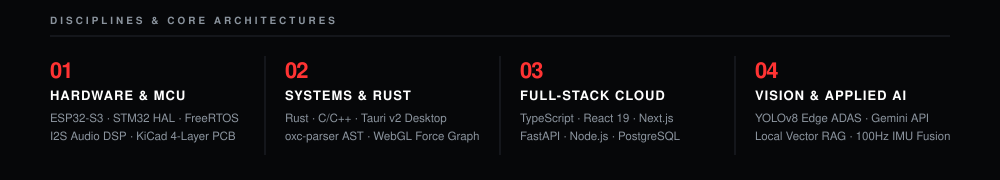
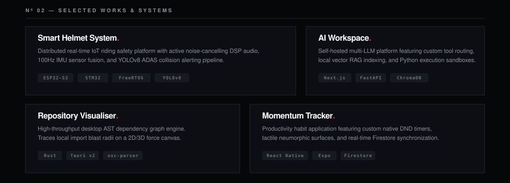
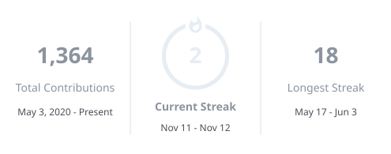

  

  <a href="https://anvv.tech"><code>PORTFOLIO ↗</code></a>&nbsp;&nbsp;·&nbsp;&nbsp;
  <a href="mailto:dasanuvab38@gmail.com"><code>EMAIL ↗</code></a>&nbsp;&nbsp;·&nbsp;&nbsp;
  <a href="https://www.linkedin.com/in/anv-dev/"><code>LINKEDIN ↗</code></a>&nbsp;&nbsp;·&nbsp;&nbsp;
  <a href="https://github.com/Stewy8506"><code>GITHUB ↗</code></a>

  

  

  

  

  

  

  
  &nbsp;&nbsp;&nbsp;&nbsp;
  

  

